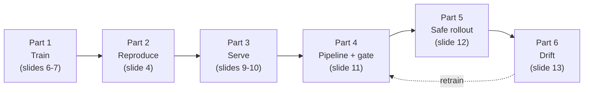
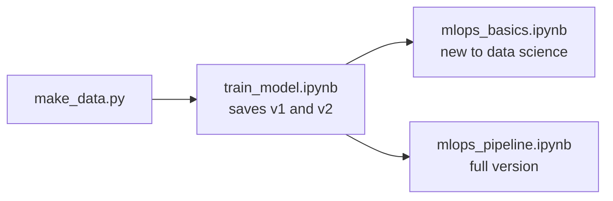

# MLOps 101 Lab: Spam Classifier

A short, hands-on lab that goes with the **MLOps 101** slides ([slides/MLOps-101.pptx](slides/MLOps-101.pptx)), from the 5350 Applied Deep Learning course. You will take a tiny spam classifier from "trained once on a laptop" to "retrained by a pipeline, protected by a quality gate, and monitored for drift."

There are two ways to do the lab. Both tell the same story with the same data:

- **Command line:** Python scripts, following [IN_CLASS_LAB.md](IN_CLASS_LAB.md).
- **Notebooks:** three Jupyter notebooks, each with a Starter section (TODOs) and a Solution section.

| Document | Who it is for |
|---|---|
| [IN_CLASS_LAB.md](IN_CLASS_LAB.md) | **Students, command line.** Step-by-step lab to follow in class |
| [PRECISION_RECALL_101.md](PRECISION_RECALL_101.md) | **Students.** Plain-language guide to precision vs recall, the threshold trade-off and F1, with examples (slide 14) |
| [train_model.ipynb](train_model.ipynb) | **Students, notebooks, step 1.** Train v1 and v2; accuracy, precision, recall, F1 and the decision threshold |
| [mlops_basics.ipynb](mlops_basics.ipynb) | **Students new to data science, step 2.** The five big MLOps steps with short TODOs |
| [mlops_pipeline.ipynb](mlops_pipeline.ipynb) | **Students, step 2, full version.** Registry, gate, API, pipeline, rollback, shadow/canary/blue-green, drift |
| [azure-mlops/](azure-mlops/README.md) | **Advanced, on Azure.** The same loop with AutoML models in Azure Machine Learning: pipelines, managed endpoints, AutoML retraining, GitHub Actions |
| [INSTRUCTOR_GUIDE.md](INSTRUCTOR_GUIDE.md) | Instructor. Timing, slide mapping, talking points, common problems |
| [SOLUTION.md](SOLUTION.md) | Instructor (share after class). Answers and expected output |

## Where the lab fits in the slides



Slides 14–16 introduce the notebooks: the metrics (14), which notebook to run (15) and what students will see (16).

## Quick start: command line

```bash
pip install -r requirements.txt
python make_data.py      # optional: the datasets are already in data/
python train.py data/sms_real_1k.csv v1
```

Then follow [IN_CLASS_LAB.md](IN_CLASS_LAB.md).

## Quick start: notebooks

```bash
pip install -r requirements.txt jupyterlab
jupyter lab
```

All the datasets are already in `data/`. Running `python make_data.py` is optional: it recreates exactly the same files (fixed seed).

Then run the notebooks in this order:



1. **[train_model.ipynb](train_model.ipynb)** trains v1 (imbalanced data) and v2 (balanced data), and saves both as `models/model_nb_v1.pkl` and `models/model_nb_v2.pkl`, each with a `.json` model card. Run it all the way through first.

   > **Stuck on this notebook?** Run `python make_solution_models.py`. It trains v1 and v2 exactly as the notebook's solution does and saves the same four files, so you can go straight to step 2.
2. Then pick **one**:
   - **[mlops_basics.ipynb](mlops_basics.ipynb)**, if you are new to data science: save versions, quality gate, serve, retrain and roll back, watch for drift. Every TODO is one or two lines.
   - **[mlops_pipeline.ipynb](mlops_pipeline.ipynb)**, the full version, following slides 4–13: everything in the basics notebook plus reproducibility checks, data validation, shadow/canary/blue-green rollouts, a refreshed test set and an automated weekly job.

Each notebook's Solution section (Part B) runs on its own from top to bottom. The diagrams are Mermaid charts: they render in JupyterLab 4.1+, Notebook 7.1+ and VS Code.

## Optional: run the app in Docker

The [Dockerfile](Dockerfile) packages the Streamlit app (`app.py`) with the production model. The [Makefile](Makefile) wraps the Docker commands. It needs Docker Desktop (or another Docker engine) and `make`.

The image includes `models/production.pkl`, so create it first (Part 4a of the lab does this):

```bash
python pipeline.py data/new_week_ok.csv
```

Then:

| Command | What it does |
|---|---|
| `make build` | Builds the `spam-lab` image |
| `make run` | Starts the app in the background at <http://localhost:8501> (replaces any running copy) |
| `make stop` | Stops and removes the container |
| `make logs` | Follows the app's logs (Ctrl+C to quit) |
| `make restart` | Rebuilds the image and starts it again, for example after the pipeline promotes a new model |
| `make clean` | Stops the container and deletes the image |
| `make help` | Lists the targets |

To use another port, run `make run PORT=8502`. Without `make` (for example on Windows), use the plain commands:

```bash
docker build -t spam-lab .
docker run -d --name spam-lab -p 8501:8501 spam-lab
docker rm -f spam-lab
```

## Optional: deploy to the class cloud VM

The same container can run on the shared class VM. Everyone uses the same machine, so you work only in **your own folder** and give your container **your own name and port**. In the commands below, replace:

| Placeholder | Replace with | Example |
|---|---|---|
| `<VM_IP>` | The VM's IP address, given in class | `20.115.42.10` |
| `<user>` | Your login on the VM, given in class | `student07` |
| `<name>` | Your first name or student ID, lower case, no spaces | `maria` |
| `<port>` | Your port, between 8000 and 8010, given in class (unique per student) | `8003` |

**1. Log in to the VM**

```bash
ssh <user>@<VM_IP>
```

**2. Go to your personal folder and get the code**

```bash
mkdir -p ~/<name>
cd ~/<name>
git clone https://github.com/iportilla/MLOps-notebooks-5350.git
cd MLOps-notebooks-5350
```

Run every command from here on inside `~/<name>/MLOps-notebooks-5350`. Do not change other students' folders.

**3. Add the production model**

The image needs `models/production.pkl`, which is not in the repository. Pick one:

- **Copy the one you made in the lab.** On the VM, run `mkdir -p models`. Then in a terminal on **your laptop**, from your local copy of the repository:

  ```bash
  scp models/production.pkl <user>@<VM_IP>:~/<name>/MLOps-notebooks-5350/models/
  ```

- **Or create it on the VM:**

  ```bash
  python3 -m venv .venv
  . .venv/bin/activate
  pip install -r requirements.txt
  python pipeline.py data/new_week_ok.csv
  ```

**4. Pick your port**

The VM's firewall only lets in ports **8000 to 8010**, so the default 8501 cannot be reached from your laptop. Each student gets one port in that range, and no two students may use the same one. Inside the container the app still listens on 8501; `PORT` only sets the port on the VM that forwards to it (`-p <port>:8501`).

You set the port when you start the container, with `PORT=<port>`. You do not need to edit the Makefile or the Dockerfile. To check which ports are already taken:

```bash
docker ps --format '{{.Names}}  {{.Ports}}'
```

**5. Build and run your container**

```bash
make build IMAGE=spam-lab-<name>
make run IMAGE=spam-lab-<name> CONTAINER=spam-lab-<name> PORT=<port>
```

Always pass the same `IMAGE`, `CONTAINER` and `PORT` values. The defaults (`spam-lab`, port 8501) are shared by everyone on the VM, so using them would stop or overwrite another student's app.

**6. Open the app**

In the browser on your laptop, go to `http://<VM_IP>:<port>`.

**7. Update, inspect and clean up**

```bash
make logs    CONTAINER=spam-lab-<name>
make restart IMAGE=spam-lab-<name> CONTAINER=spam-lab-<name> PORT=<port>
make stop    CONTAINER=spam-lab-<name>
make clean   IMAGE=spam-lab-<name> CONTAINER=spam-lab-<name>
```

Use `make restart` after copying in a new `production.pkl`. To move to a different port, run `make run` again with the new value, for example `make run IMAGE=spam-lab-<name> CONTAINER=spam-lab-<name> PORT=8005`: it stops your old container and starts it on the new port. No rebuild is needed. Run `make clean` at the end of class so the VM does not fill up with old images.

## Files

```
MLOps-notebooks-5350/
├── README.md              # this file
├── slides/MLOps-101.pptx  # the MLOps 101 slides (17 slides)
├── IN_CLASS_LAB.md        # student lab, command-line version
├── INSTRUCTOR_GUIDE.md    # timing, slide mapping, talking points
├── SOLUTION.md            # answers and expected output
├── PRECISION_RECALL_101.md  # precision vs recall, thresholds and F1, explained
│
├── train_model.ipynb      # notebook 1: train v1 and v2, metrics, model cards
├── mlops_basics.ipynb     # notebook 2 (beginner): the five major MLOps steps
├── mlops_pipeline.ipynb   # notebook 2 (full): the whole MLOps loop
├── azure-mlops/           # advanced: the loop on Azure ML with AutoML models (see its README)
│
├── common.py              # shared code: features, train, evaluate
├── make_data.py           # creates the synthetic datasets
├── make_solution_models.py  # creates v1 and v2 as train_model.ipynb would (for notebooks 2 and 3)
├── train.py               # train one model + write its model card
├── predict.py             # classify a message with a saved model
├── pipeline.py            # ingest -> retrain -> evaluate -> version -> gate/promote  (has a TODO)
├── rollback.py            # put an older model back into production
├── check_drift.py         # monitoring: has the data changed?
├── app.py                 # optional: Streamlit web app
├── Dockerfile             # optional: package the app in a container
├── Makefile               # optional: make build / run / stop / clean for the container
├── requirements.txt
└── data/
    ├── sms_real_1k.csv        # real SMS features (85% ham, 15% spam)
    ├── balanced.csv           # 1,000 ham + 1,000 spam: the base training data
    ├── test_set.csv           # the fixed test set (85% ham, 15% spam)
    ├── new_week_ok.csv        # a normal weekly batch
    ├── new_week_bad.csv       # a batch with a labeling bug (spam labeled as ham)
    └── new_week_drift.csv     # a batch where spammers send short messages
```

All six datasets are included. `make_data.py` can recreate every file except `sms_real_1k.csv`, with identical contents.

Folders created when you run things:

| Folder | Created by | Holds |
|---|---|---|
| `models/` | `train.py`, `pipeline.py`, `train_model.ipynb` | Model files, model cards, `production.pkl`, `registry.csv` |
| `mlops_nb/` | `mlops_pipeline.ipynb` | That notebook's versions, registry and production model. Emptied each time its setup cell runs |
| `mlops_basics/` | `mlops_basics.ipynb` | That notebook's versions and production model. Emptied each time its setup cell runs |

The two MLOps notebooks never touch `models/production.pkl` or `models/registry.csv`, so they do not interfere with the command-line lab.

## Troubleshooting

**`FileNotFoundError: models/production.pkl`**

`models/production.pkl` does not exist until the pipeline promotes a model in Part 4a. `predict.py` (with no model argument), `app.py`, `check_drift.py` and the Docker build (`make build`) all need it. Create it with:

```bash
python pipeline.py data/new_week_ok.csv
```

Run every script from the repository root, where `make_data.py` is. The paths are relative, so running from another folder gives the same error even when the file exists.

**`models/model_nb_v1.pkl is missing` in an MLOps notebook**

Run all of `train_model.ipynb` first. It saves the two models the MLOps notebooks start from. If you could not finish it, run `python make_solution_models.py` instead: it creates the same two models.

**`Finish the TODO ...` or `The registry should have v1 and v2`**

A starter cell still has an unfilled `# TODO`. Fill it in, or copy the matching cell from Part B, then run the cell again.

**`mlops_nb/versions/v2.pkl does not exist`**

Section 1c of `mlops_pipeline.ipynb` registers v1 and v2. Run it before the later sections. If you re-ran the setup cell, it emptied `mlops_nb/`: run every cell after it again.

**Cloud VM: `permission denied ... docker.sock`**

Your VM user is not allowed to run Docker. Ask the instructor to add you to the `docker` group, then log out and back in.

**Cloud VM: the page at `http://<VM_IP>:<port>` does not load**

Check that the container is running with `docker ps --filter name=spam-lab-<name>`, and look at `make logs CONTAINER=spam-lab-<name>`. If it is running, the port is probably blocked by the VM's firewall: check that your port is between 8000 and 8010 and is the one assigned to you.

**Cloud VM: `port is already allocated`**

Another container is using that port. Run `docker ps --format '{{.Names}}  {{.Ports}}'` to see who has it, then use the port assigned to you (8000–8010), not the default 8501.

**Diagrams show up as text starting with `flowchart`**

Your Jupyter is older than JupyterLab 4.1 / Notebook 7.1. Upgrade with `pip install -U jupyterlab`, or open the notebook in VS Code. The code cells work either way.
